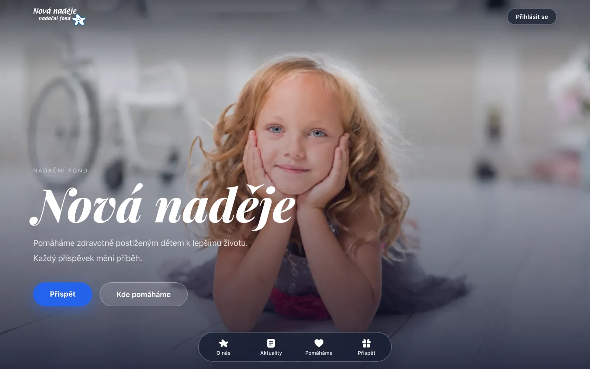
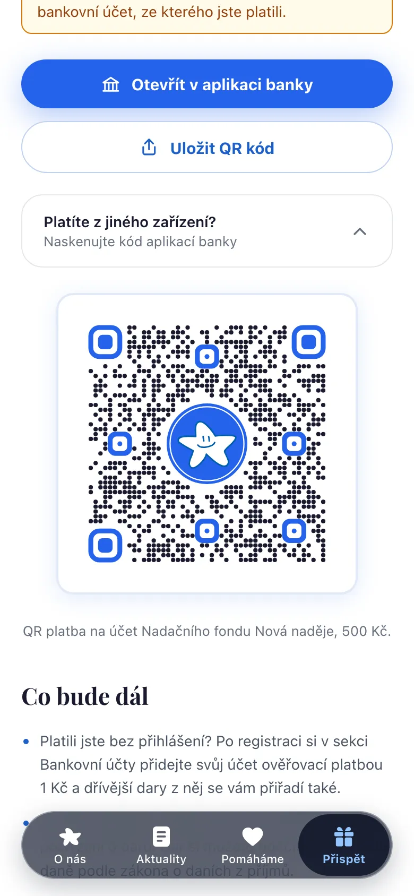
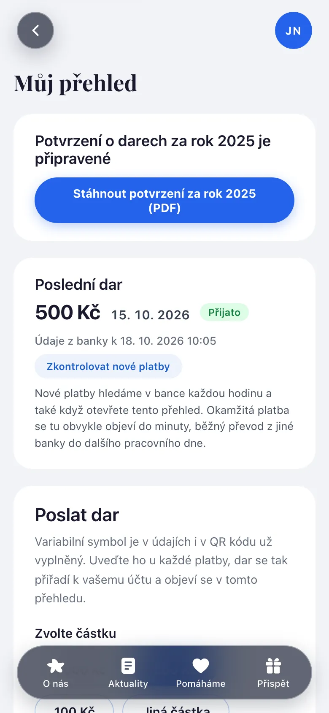
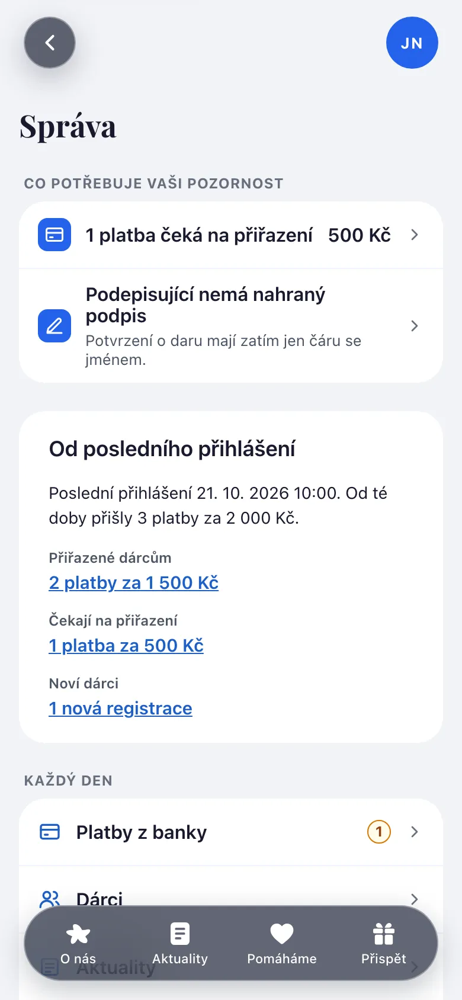
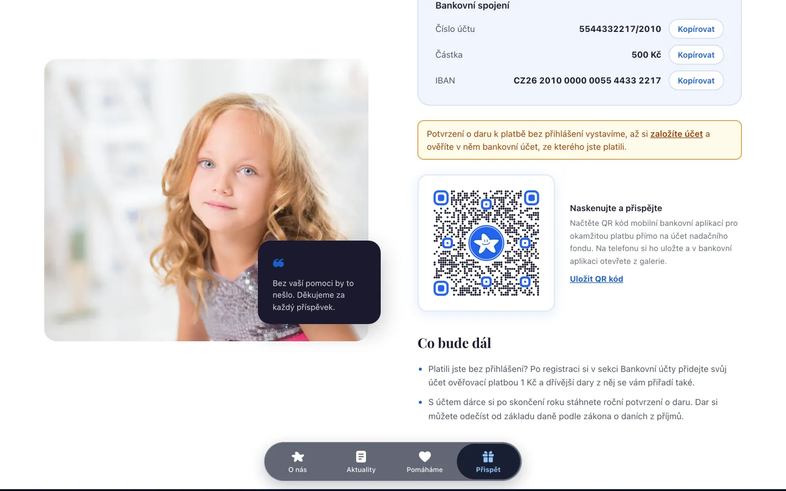
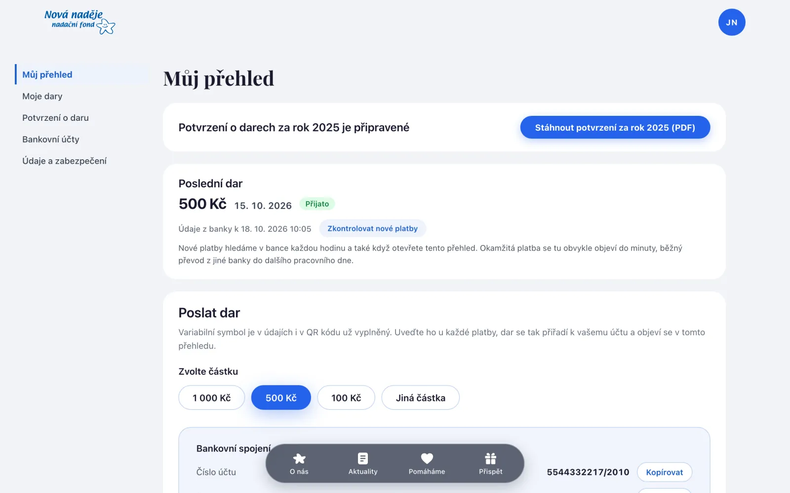
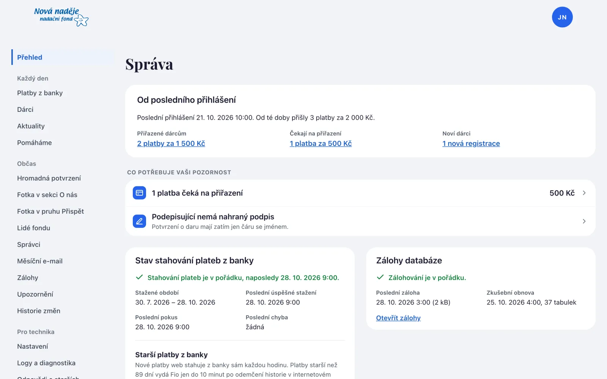
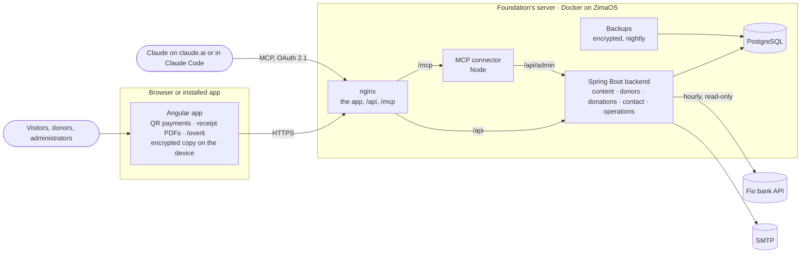

<p align="center">
  <a href="https://nfnn.cz">
    <picture>
      <source media="(prefers-color-scheme: dark)" srcset="frontend/src/themes/nova-nadeje/assets/images/logo-on-dark.svg" />
      
    </picture>
  </a>
</p>

<p align="center">
  The website of <strong>Nadační fond Nová naděje</strong>, a Czech foundation that helps children with health disabilities.<br />
  A public site, a donor account with tax receipts, and an administration the foundation runs on its own.
</p>

<p align="center">
  <a href="https://nfnn.cz"><strong>nfnn.cz</strong></a> ·
  <a href="docs/system-overview.md">How it works</a> ·
  <a href="docs/security-overview.md">Security</a> ·
  <a href="docs/roadmap.md">Roadmap</a> ·
  <a href="deploy/README.md">Deploy</a> ·
  <a href="#contributing">Contributing</a>
</p>

<p align="center">
  <a href="https://github.com/bzumik1/nfnn/actions/workflows/pr-check.yml"></a>
</p>

<p align="center">
  
</p>

<table>
  <tr>
    <td align="center" width="25%">
      
      <br /><sub>Home</sub>
    </td>
    <td align="center" width="25%">
      <picture>
        <source media="(prefers-color-scheme: dark)" srcset="docs/images/readme/donate-phone-dark.webp" />
        
      </picture>
      <br /><sub>Přispět: QR payment</sub>
    </td>
    <td align="center" width="25%">
      <picture>
        <source media="(prefers-color-scheme: dark)" srcset="docs/images/readme/donor-phone-dark.webp" />
        
      </picture>
      <br /><sub>Donor account</sub>
    </td>
    <td align="center" width="25%">
      <picture>
        <source media="(prefers-color-scheme: dark)" srcset="docs/images/readme/admin-phone-dark.webp" />
        
      </picture>
      <br /><sub>Administration</sub>
    </td>
  </tr>
</table>

<details>
<summary>On a computer</summary>
<br />

<picture>
  <source media="(prefers-color-scheme: dark)" srcset="docs/images/readme/donate-desktop-dark.webp" />
  
</picture>

<picture>
  <source media="(prefers-color-scheme: dark)" srcset="docs/images/readme/donor-desktop-dark.webp" />
  
</picture>

<picture>
  <source media="(prefers-color-scheme: dark)" srcset="docs/images/readme/admin-desktop-dark.webp" />
  
</picture>

</details>

<sub>Screenshots use the fictional data of the end-to-end test mocks. Except the home page, they follow your GitHub theme: switch between light and dark to see both appearances.</sub>

## What it does

This is what `main` does. The server runs the revision in [`.github/deployed-revision`](.github/deployed-revision), and [`docs/roadmap.md`](docs/roadmap.md) says what is still being built.

- **Public site.** Who the foundation is and who leads it, news ("Aktuality") and stories of the people it helps ("Pomáháme"), and a contact form. **Přispět** turns a chosen amount into a QR payment drawn in the browser; on a phone, "Otevřít v aplikaci banky" hands the payment to the bank app, as a payment file on Android and as the QR image through the share sheet on iPhone.
- **Donor account** (`/darce`). Gifts arrive by bank transfer and are matched to the donor by their variable symbol, or by a bank account that has already sent a gift with that symbol (a 1 Kč payment is enough to add one). The donor sees their gifts by year and downloads yearly and single-gift receipts for the tax return as PDFs, which the browser draws from the data the server issued. Passkeys and an authenticator app protect the account.
- **Receipt verification** (`/overit`). Every receipt carries a QR code with the foundation's Ed25519 signature over what is printed on it; anyone can check it with a phone camera, and the signature is verified in the browser.
- **Administration** (`/sprava`). Payments from the bank and manual pairing, donors, news and stories in Markdown with photos, the people of the foundation and who signs the receipts, bulk receipts for a year, the monthly report e-mail, encrypted nightly backups with weekly test restores, logs and diagnostics, and a history of every change. Only administrators with a second factor get in.
- **Bank import.** Every hour the backend reads new payments from the Fio bank API with a read-only token. An outage of the import or of the backups is reported by e-mail and as a Web Push alert on the administrators' devices that want it.
- **A web app, local first.** The site installs on a phone or a computer, shows its public pages without a network, and keeps the donor's and the administration's data in an encrypted copy on the device, under keys that never leave it.
- **MCP connector** (`/mcp`). An administrator can connect Claude (on claude.ai or in Claude Code) to the administration over OAuth 2.1, approving each connection with a fresh second factor. It reads the administration's data and settings and, when the connection was granted changes, makes the everyday ones, issuing receipts included; deleting content, secrets, backups, the administrator role and the other steps on the web-only list stay in the browser, and every change lands in the history under the administrator's name and the connected application.

## How it works



- **Backend** ([`backend/`](backend)): Spring Boot 4.1 on Java 25 with strict domain-driven design. Five bounded contexts, `content`, `donors`, `donations`, `contact` and `operations`, plus a `shared` kernel, each split into `domain`, `application`, `infrastructure` and `interfaces/rest`. ArchUnit enforces the layers and keeps the contexts apart: they meet only through events or a port in `shared`. The schema changes only through Liquibase.
- **Frontend** ([`frontend/`](frontend)): Angular 22, standalone, zoneless and built on signals, with the whole look in a swappable theme (light and dark follow the device) and Czech copy behind i18n ids.
- **Connector** ([`mcp/`](mcp)): a Node and TypeScript MCP server that holds no secret and exchanges every token at the backend.
- **Local first.** The browser draws payment QR codes and receipt PDFs, verifies receipts and keeps an encrypted copy of the data on the device. The server assigns receipt numbers, freezes what a receipt says and signs it.
- **Security.** Another donor's data answers 404, the administrator role needs a second factor, guessing a password or a code and sending mail are rate-limited, and the Content-Security-Policy allows no inline script and nothing from another origin. The mechanisms are in [`docs/security-overview.md`](docs/security-overview.md).

| Path | What |
|---|---|
| [`backend/`](backend) | Spring Boot backend, Gradle Kotlin DSL |
| [`frontend/`](frontend) | Angular app and its nginx |
| [`mcp/`](mcp) | MCP connector of the administration |
| [`deploy/`](deploy) | Production compose for ZimaOS, the backup and PostgreSQL images, the Cloudflare outage page |
| [`shared-cases/`](shared-cases) | Inputs and expected outputs that the backend and the frontend both run |
| [`regression/`](regression) | The recorded v2 baseline every change is compared with |
| [`scripts/`](scripts) | Node and shell scripts of CI and the worktrees |
| [`docs/`](docs) | Requirements, roadmap, contracts and overviews ([map below](#documentation)) |

## Getting started

You need Docker with Compose and Buildx, a JDK 17 or newer (Gradle downloads JDK 25 itself) and Node 22.22.3+, 24.15+ or 26 (CI uses 26).

**The whole stack** (PostgreSQL, backend, connector and the frontend nginx):

```bash
cp .env.example .env
docker compose up -d --build
```

Open <http://localhost:8080>. On its first start the server asks for its settings at `/prvni-nastaveni` and generates its own keys. Registration and the first setup send e-mails with confirmation links, so give the setup an SMTP server you can read (CI uses [Mailpit](https://mailpit.axllent.org)).

**Backend** alone, with PostgreSQL in Testcontainers (needs Docker), on port 8080; it sends mail to an SMTP server on `localhost:1025`:

```bash
cd backend
./gradlew bootTestRun
```

**Frontend** dev server on <http://localhost:4200>, with `/api` proxied to the backend on port 8080:

```bash
cd frontend
npm ci
npm start
```

**Connector**: formatting, types and tests, then the build:

```bash
cd mcp
npm ci
npm run check
npm run build
```

## Tests and CI

Every change starts with a failing test, and every test reads as given, when, then.

| Area | What runs | Command |
|---|---|---|
| Backend | JUnit unit and integration tests on Testcontainers PostgreSQL, Cucumber scenarios per use case, ArchUnit | `./gradlew test` (needs Docker) |
| Frontend | Prettier, ESLint, Stylelint, Vitest, the production build, Playwright journeys with axe under the production Content-Security-Policy | `npm run format:check && npm run lint && npm run lint:styles && npm test -- --watch=false && npm run build && npm run e2e` (once before: `npm run e2e:install`) |
| Connector | Prettier, `tsc`, Vitest against a fake backend | `npm run check && npm run build` |
| Everything changed | The commands above, the installed-app tests (`npm run e2e:pwa`, needs Docker) and the comparison with v2, for the areas a branch touches | `node scripts/check-changed.mjs --run` |

On top of that, [`pr-check.yml`](.github/workflows/pr-check.yml) compares every pull request with the recorded v2 baseline and with `main` (API transcripts, the test inventory, screens), runs the cases in [`shared-cases/`](shared-cases) on both sides, checks the layout in phone and tablet poses, tests the installed web app behind the real nginx, starts the whole Docker stack and rehearses the release from the revision the server runs. A nightly run covers what is too slow or too time-dependent for every pull request, and real Safari runs on the iOS simulators and macOS for pull requests that change the frontend and once a week. The rules are in [`.claude/rules/testing.md`](.claude/rules/testing.md) and its siblings, and each CI job is described in [`docs/system-overview.md`](docs/system-overview.md#ci-in-detail).

## Deployment

A merge to `main` that changes an image publishes it to `ghcr.io/bzumik1/nfnn-*`, tagged `latest` and with the short commit. The foundation's server runs them on ZimaOS from [`deploy/compose.yml`](deploy/compose.yml), behind Nginx Proxy Manager and Cloudflare; deploying a new version is a manual step. Installation, settings, backups and restores, logs and the domain are in [`deploy/README.md`](deploy/README.md) (Czech).

## Documentation

| Document | What it covers |
|---|---|
| [`docs/requirements.md`](docs/requirements.md) | What the site does and every decision of the foundation (Czech) |
| [`docs/roadmap.md`](docs/roadmap.md) | Versions, what is in progress and the backlog (Czech) |
| [`docs/system-overview.md`](docs/system-overview.md) | How each bounded context, the regression suite and CI work today |
| [`docs/frontend-overview.md`](docs/frontend-overview.md) | What the Angular app contains and its conventions |
| [`docs/security-overview.md`](docs/security-overview.md) | Authentication, connected applications, receipts, device copies, limits and logs |
| [`docs/api-contract.md`](docs/api-contract.md) | The HTTP API and the MCP connector's tools |
| [`docs/glossary.md`](docs/glossary.md) | The Czech UI word and the English code name of every domain term |
| [`deploy/README.md`](deploy/README.md) | Running the production server (Czech) |
| [`CLAUDE.md`](CLAUDE.md) and [`.claude/rules/`](.claude/rules) | The rules every contributor and coding agent follows |

## Contributing

A small team builds the site together with coding agents, so the rules for people and agents are the same: [`CLAUDE.md`](CLAUDE.md), with [`AGENTS.md`](AGENTS.md) pointing other agents to it.

- Search the open issues and pull requests first; work that takes more than one sitting gets an issue from the [templates](.github/ISSUE_TEMPLATE) (Task or Bug report).
- One problem per pull request, from a branch off `main`, with the description from the [pull request template](.github/pull_request_template.md). Code, commits and titles are in English; the UI and its decisions are in Czech.
- How several people and agents keep their work in sync is in [Working alongside others](CLAUDE.md#working-alongside-others).

## Reporting a vulnerability

Please do not open a public issue. Write to [info@nfnn.cz](mailto:info@nfnn.cz) with what you found and how to reproduce it.

## License

No license has been chosen yet. The code is public to read, but until a license is added, no permission to use, copy or modify it is granted.
